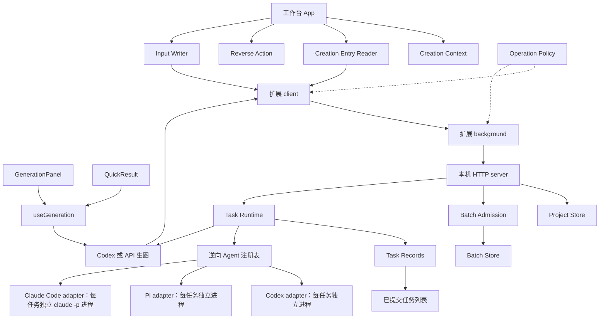

# Reframe 架构与维护边界

Reframe 保持扩展 UI、扩展后台、本机 bridge 三个执行环境。共享业务规则集中在明确的 module 中，界面保留导航、布局与效果，HTTP 入口保留鉴权、参数解析与执行装配。领域词汇见 [GLOSSARY.md](../../GLOSSARY.md)，产品约束见 [AGENTS.md](../AGENTS.md)。



## 创作上下文

`lib/creation-context.ts` 的 interface 包括 reducer、上下文解析、快捷草稿过滤和输入 writer。它集中保存此前散落在 App 闭包中的优先级与失效规则，减少跨函数追踪状态的成本。

- 草稿以 `projectId:mode:version` 隔离，优先于对应当前输入与历史快照。当前输入仅用于当前版本或尚未逆向的输入；历史版本使用当次参考图，缺图不回退到别的版本。
- 外部较新 `inputRevision` 使项目工作输入草稿失效；本地保存只清理对应当前草稿，保留历史草稿。提示词正文编辑继续由独立草稿管理。
- `createInputWriter` 同步防重入，发送输入 revision，并在响应到达时核对上下文对象身份和导航 revision。检查通过与 commit 回调在同一段同步执行中完成，不能在两者间再插入 `await`。
- writer 丢弃旧响应只影响界面接收。服务端可能已经成功保存；后续重新读取项目按服务端 revision 恢复，不伪造撤销。

不把所有 UI 状态塞入领域 reducer。`entrypoints/popup/App.tsx` 是两端共用的组合根：持有 React 状态与布局，把 setter 和 revision ref 交给以下 module，自身只保留输入上传/保存/换序、提交与删除等直接接线。

| module | interface | 职责 |
| --- | --- | --- |
| `lib/surface-sync.ts` | `createSurfaceSync(env)` → `start / dispose / openNotice / openTask / navigateReminder / navigateHandoff / onHashChange` | 启动顺序为项目视图、初始 query 入口或快捷已保存草稿、提醒导航与轮询建立、最后消费 hash；Quick 的 ownContext 与全局选择变化；初始化完成前 toast 明确报错，任务中心则静默等待。 |
| `lib/service-health.ts` | `pollServiceHealth(env, projectId)` → cleanup | 健康轮询（忙碌 2s、空闲 10s）、连接/Agent/模型状态，缺 `projectsRevision` 视为 legacy；项目 revision 变化才带已保存 revision 重取项目；`projectRevision` 防止旧轮询覆盖新的本地变更，生图设置 token 过期的读取整体丢弃。 |
| `lib/generation-settings.ts` | `createGenerationSettings({ request, query, publish })` → `save / apply / token / current` | 渠道设置写入与健康轮询串行：写入替换 token，之前或期间开始的轮询被丢弃。 |
| `lib/project-inputs.ts` | `hydrateProjectInput`、`openProject`、`restoreJobReference`、`inputConflict` | 按 inputRevision 水合一次；其他窗口提交了更新时报冲突而不静默替换；重开是陈旧窗口的显式恢复路径。 |
| `lib/project-visibility.ts` | `projectVisibilityActions(env, view)` | 隐藏/恢复与隐藏范围切换；只采用服务端确认的 ID，响应不替换请求期间新打开的项目。 |
| `lib/workspace-handoff.ts` | `workspaceContext`、`draftSnapshot`、`projectDraft`、`createWorkspaceOpener` | 交接只带来源引用和当前项目草稿，固定当前显示的版本；打开工作台同时只有一次。 |
| `lib/prompt-export.ts` | `promptMarkdown(job)` | 附图顺序取任务冻结的 referenceIndex，旧记录保持主体在前、参考最后。 |

长生命周期的 surface sync 与取消锁持有首次渲染的 env，只能通过稳定 setter 与 ref 读写；需要最新渲染值的逻辑以参数传入（如 `projectVisibilityActions` 的 view）。

`lib/creation-entry.ts` 的 `createEntryReader({ request, query, revision })` 只读取 handoff 或提醒任务。`read(entry, accept)` 捕获界面的 selectionRevision，在每次异步返回、继续读取和同步交付前检查归属；surface sync 每次导航（含 unread 与无效 ID）递增 revision，`dispose()` 时一并释放 reader，使在途及后续读取失效。handoff 先交付 `handoff-source`，再按持久引用的 inputRevision（缺省为 0）交付 fresh/stale/unavailable；stale 剥除输入，引用失败保留来源和 selection.error，未保存与空来源保持不同状态。提醒按任务 ID 读取任务及项目引用，一起交付。reader 不修改调用方对象、不写输入；surface sync 负责草稿恢复、stale 的 revision -1 与提示、settings/tasks 路由、版本及结果抽屉。

`lib/reverse-action.ts` 的 `deriveReverseAction` 消费 resolveCreation 的结果，统一五模式的提示词失效、错误提示优先级、逆向/连续动作资格和 reenact payload，不重复输入回退规则。App 用原有尺寸继承及真实尺寸 helper 提供 sizeValid，保留 Magpie 回退和普通比例校验；`reverseSubmission` 只在对应动作可用时给出提交参数，再交给 App 的 start。`createReverseCancellation` 按任务同步加锁，点击时捕获的任务只取消一次，其他任务仍可取消。提交锁、任务指令、sessionIds、图序与输入快照仍由 start 负责，持久输入 writer 与 generation-session 的所有权不变。

`lib/use-input-operation.ts` 为 CanvasWorkspace 和 QuickWorkspace 统一输入操作的同步防重入、忙碌与错误、上下文 revision 和 React cleanup。读取完成后先检查操作归属，再调用已有保存入口；保存后的选择与焦点回调和归属检查同步执行。离开再返回同一上下文也会使旧操作失效，旧结果不能释放新操作的占用或提交保护。失败释放编辑锁但保留提交阻止，成功重试或明确移除恢复可用性。

组件保留图片校验与尺寸、多图元数据、选择、焦点和旋转错误传播。Quick 排序由 App 维护 availability，成功提交回调经操作归属检查后设置组件的 `focusAfterOrder`，供渲染后恢复焦点；不套用上传的 availability 通知。hook 不保存输入、不取消已经发出的写入；`creation-context` writer 仍是唯一持久输入写入入口与 CAS 协调者。

## 共享生图行为

`lib/generation-session.ts` 提供 `generationReadiness` 和 `createGenerationSession`；`lib/use-generation.ts` 是 React adapter。工作台和快捷结果共用资格判断、提交参数、取消、同步防重入、失败状态、图片及参考快照读取。

每个挂载中的提示词版本有自己的生图会话。图片读取用序号丢弃迟到结果；版本离开后不再更新其展示，但已经提交的请求仍通过原版本 onUpdate 更新数据、onRequestState 收尾原抽屉。清理当前历史图片定位属于独立 onViewUpdate，仅允许原挂载生命周期、创作上下文及导航轮次仍有效时执行，离开再返回也不能接收旧请求的视图动作。关闭界面不取消本机任务。实际布局、抽屉、语言、尺寸控件与图片操作留在各自组件中。

这个 seam 有两个实际 UI adapter，改动一处即可覆盖两端；不引入通用表单框架或全局事件总线。

## 逆向 Agent

`bridge/agents.mjs` 是逆向 Agent 的 seam。`createAgentRegistry({ dataDir, adapters })` 校验并登记 adapter，持久化当前选择（`agent-settings.json`，原子替换），向界面提供 `view()` 目录（ID、名称、当前模型、是否可安装及最近一次检测到的 CLI 安装情况），`detect()` 供 `GET /agents?detect=1` 在本机检查所有 adapter 的 CLI（只看安装与版本，不查询更新），未检测或检测失败为 `null`（未知），不等同于未安装；并以 `frozen(snapshot)` 按任务冻结的 `modelSettings.agent` 解析执行者：缺少字段按 `LEGACY_AGENT`（Codex）解释，未登记 ID 明确失败，不回退到当前选择。`builtinAgents()` 装配现有 Codex、Pi 与 Claude Code adapter；新增本机 Agent 只需在此登记一个对象：

```js
{ id: "my-agent", label: "My Agent", models, cli?, run, compatibility? }
// run({ input, schema, instructions, dynamicTools, cwd, dataDir, signal, onProgress, modelSettings }) → { text }
// models：createModelStore 实例（目录、验证、选择、busy、close）；cli 可选，提供 install 时界面显示安装入口
```

`bridge/agent.mjs` 只构造 Alchemy 输入、图片顺序、取证工具和输出合同，再调用冻结 adapter 的 `run`，不认识具体 Agent。`reverseInstructions()` 把受理时冻结的插件指令接在 Reframe 逆向规则之后、放进 `<plugin-instructions>` 边界并声明其优先级低于本次任务指令；三个 adapter 都以这段 `instructions` 构造系统提示，因此插件指令覆盖全部 Agent 与路径，不进入用户输入项。`plugin-instructions.mjs` 读取随插件分发的 `plugin-instructions.md` 与私有覆盖 `config/plugin-instructions.md`，`GET/POST /plugin-instructions` 仅供扩展使用，保存在服务 mutation lock 内按 revision 拒绝旧版本并原子替换。`codex-agent.mjs` 是 Codex adapter（app-server JSON-RPC，也供模型验证与 Codex 内置生图复用）；`models.mjs` 为每个 adapter 独立保存模型选择，切换不改动全局 CLI 设置或凭据。扩展端 `lib/agents.ts` 只校验 ID 格式并构造 `?agent=` 查询，支持哪些 Agent 由 bridge 注册表决定；界面名称来自目录，不再硬编码 Codex/Pi。设置未完成（未选模型或 Codex 缺失）时，`lib/use-agent-detection.ts` 请求检测；`missingAgentCli`/`setupNotice` 只在所选 Agent 的 CLI 被检测为缺失时列出已安装的其他 Agent，由用户在卡片上切换，不自动改变选择。

Codex 逆向、内置生图与模型验证在每次新建、结束即删除的私有空目录中运行（`withPrivateFolder`）。`thread/start` 以 `baseInstructions` 替换 Codex 自带的基础提示词，内容只有 Reframe 任务说明和所选路径的技能快照；参考资料经 `alchemy_read_reference` 按快照内的名称读取，不再发送 skill 输入项。`config` 只为本次线程叠加 `ISOLATION`：不读项目 AGENTS.md，不附权限、环境、协作模式与 Apps 说明，关闭技能目录、网页搜索、子 Agent、插件、Apps、浏览器、hooks、shell 及其启动时的 shell 环境快照、文件看图与向用户提问，生图只在内置生图线程开启，并把当前生效配置里的每个 MCP server 设为 `enabled: false`（按表写入，名称可含点）；不写 `~/.codex`。CLI 没有开关的部分仍会进入上下文：用户全局 `~/.codex/AGENTS.md`，以及模型目录固定的 code-mode 工具（`exec`/`wait`、apply_patch、时钟、MCP 资源列表等；sandbox 只读，且没有可用的 MCP server）。模型目录也在私有目录读取，使账号上下文与逆向一致，不受 bridge 目录的项目设置影响。内置生图的 `baseInstructions` 只有 Reframe 生图规则，输入只有已确认提示词、排除项和按受理顺序的图片，不发送 skill 输入项，也不提供 Reframe 工具；生图的账号与模型上下文同样在私有目录读取。兼容性检查要求 `thread/start` 支持 `baseInstructions`，缺失时禁用逆向与内置生图，模型列表不受影响。

`bridge/pi-agent.mjs` 管理 Pi 子进程协议、模型目录、错误与取消；`pi-extension.mjs` 只开放本次图片取证及技能资料读取。图片操作复用 `inspection.mjs`，没有第二套裁切规则。Pi 不提供 Codex 的 OS sandbox，因此通过禁用默认工具、个人扩展和上下文文件限制模型可调用能力；该限制不声称隔离 CLI 自身或模型服务。

`bridge/claude-agent.mjs` 每个任务启动一个 `claude -p` 进程（stream-json 输入输出），只使用 Claude Code 文档列出的参数：`--setting-sources ""` 不加载用户、项目和本地设置（因此不运行 hooks、不读 CLAUDE.md，也不使用设置文件中的 `apiKeyHelper`/`env`），`--tools ""` 关闭内置工具，`--strict-mcp-config` 只加载本次 `--mcp-config`，`--allowedTools` 只放行 Reframe 两个工具，`--no-session-persistence` 不保存会话，`--json-schema` 约束结果。`claude-mcp.mjs` 是这次任务的 stdio MCP 服务，只从私有任务清单读取本次图片和技能资料，取证复用 `inspection.mjs`，并按 Claude 的图片上限（单边 2000px、单图约 3.75MB）缩小输出；图片按图序内联在用户消息中。启动后核对 `system/init` 的工具与 MCP 状态，出现预期外工具或 Reframe 工具未连接时明确失败；响应模型与所选模型不符时停止。账号上下文取自 `claude auth status --json`、`-p` 模式下优先生效的环境凭据（API Key、令牌、Bedrock/Vertex/Foundry 变量，只进入单向哈希）、所选云服务共享凭据文件的元数据与实际可执行文件，变化后要求重新验证。子进程不继承启动 bridge 的 Claude Code 会话：`CLAUDE*`、`AI_AGENT`、`MCP_*` 命名空间内只保留登录、提供方与证书设置（`SETTINGS_ENV`），宿主会话的身份、邮箱、消息通道、推理强度和工具开关都不传入；另设 `DISABLE_AUTOUPDATER` 与 `CLAUDE_CODE_DISABLE_AUTO_MEMORY`。CLI 仍固定附带 Agent SDK 身份行，以及环境（cwd 为任务临时目录）、模型与日期提醒。CLI 没有文档化的模型列表命令，模型目录因此读取 stream-json 的 initialize 握手（官方 Agent SDK `supportedModels()` 的同一来源），读取目录不调用模型。

任务和排队批次冻结逆向 Agent/provider/model/推理参数与插件指令（批次视图不公开指令正文）；自动生图另冻结所选生图渠道、模型及 API 配置。两阶段仍由既有 Task Runtime 和 Batch Store 调度，取消、保存失败及重启恢复使用原规则。会话正文读取独立使用 Codex，只把既有显式快照交给所选逆向 Agent。

CLI 管理由 `cli.mjs`、`pi-cli.mjs` 与 `claude-cli.mjs` 分别验证安装来源，复用固定参数的子进程执行器。`/cli/*?agent=<id>` 与 `/models?agent=<id>` 显式指定已登记的管理目标；省略时兼容 Codex。安装更新与任务、模型验证全局互斥，完成后只清除对应 Agent 的模型信任；Codex 更新还复查兼容性并重建会话读取器。

Pi 新安装使用固定官方 npm 包、私有暂存目录和禁用生命周期脚本的安装参数；验证成功后原子替换当前安装指针。外部 npm 安装先核对包身份、真实入口和运行时；具备原生自更新能力时调用原 CLI 的固定 `update --self --no-approve`，由 Pi 从自身安装位置确定原 prefix，不把资源包更新当作 CLI 升级。不支持原生自更新时仍仅允许已验证 npm manager 的原 prefix 更新。更新后复检路径、版本与 Reframe 接口；失败或取消时，已发生部分替换也须清除旧模型信任。App 或无法确认来源的安装不自动覆盖。Claude Code 只对官方安装器的 `~/.local/bin/claude` 入口（指向 `versions/<版本>`）运行固定的 `claude update`；npm、Homebrew、桌面 App 与自定义安装只显示原渠道的更新方式，并以 npm `stable` 标签作版本参考。管理操作不接受任意命令或路径，也不读取或复制登录凭据。设置中的管理目标独立于已保存的逆向 Agent；旧 `section=cli`、Pi 与 Claude Code 恢复入口只定位对应管理区域。

## Bridge 装配

`bridge/server.mjs` 只负责启动恢复、鉴权与 Host/Origin 校验、mutation lock、POST `/jobs` 受理及各模块装配。路由按职责拆分到 `bridge/routes/`：`service.mjs`（健康、会话、Agent/模型/CLI 管理、生图设置、重启）、`projects.mjs`（项目、图库、批次、任务 feed）、`jobs.mjs`（任务读取、提示词、生图与文件操作）。每个路由模块签名为 `(request, app) → handled`，`app` 是 server 显式传入的依赖集合，没有全局状态。`bridge/http.mjs` 拥有请求体读取、图片与主体解码及错误映射；`bridge/batch-scheduler.mjs` 拥有批次公开视图与空闲时启动下一项的泵，停止条件由 server 注入。

bridge 只接受本机 Host；带 Origin 的请求必须是已批准的扩展 Origin，不带 Origin 的本机客户端（例如后续 CLI）凭 `.local/config/token`（`0600`）中的 Bearer token 调用同一 HTTP interface，不需要另一套服务。

## 生图渠道

`bridge/generation-preparation.mjs` 统一独立生图、连续流程及批次的渠道选择、Codex context 读取、渠道尺寸校验、尺寸快照与依赖检查。`prepare` 为新请求选择配置并计算快照；已受理配置及尺寸直接复用，`restoreBatch` 保留旧批次尺寸的既有解释并检查凭据快照，不重新归一化。Magpie 舍入算法仍归 `lib/image-size.mjs`。`check` 按原配置复查目录或 Codex 生图能力；原 Magpie 模型下架时自动生图失败，保留已提交提示词，不读取当前渠道替代，也不创建 generation。

选项校验与准备、依赖检查分开，保留各入口的校验顺序：批次预检没有语言字段，同键受理恢复先于当前依赖检查；手动生图先检查任务和提示词资格，在准备之后验证图片，再检查依赖、保存主体并保留运行占用。Codex context 异步读取后重新检查取消、CLI 和模型验证状态。HTTP 与任务编排继续拥有素材、图序、提示词、取消检查及提交点，准备模块不写入输入或调度任务。

Magpie 是新增 API 网关入口，`magpie.mjs` 只负责本机地址规范化、应用身份与只读目录，不实现厂商路由。`/image-models` 仅供扩展页面连接：验证 `/api/hello`，读取 `/v1/models`，筛选 kind=image 且 output 包含 image，返回有限安全字段。禁止远程地址、地址内凭据与重定向；目录大小和耗时有界。健康状态与受理共用配置完整性规则，Magpie 无需供应商 Key；受理时确认完整模型仍在生图目录，失败不自动选其他模型。

Magpie 文生图使用 Images JSON generations，附图使用 multipart edits，沿提示词版本的图序重复发送 `image[]`，固定 `n=1`。目录 input 元数据不作为 edits 的硬门禁，也不代表真实附图能力已验证。手动、连续和批量均固定受理时的渠道、模型、素材与尺寸。`imageSize` 独立于旧 `aspectRatio`，保存正有限的用户请求意图；共享 `lib/image-size.mjs` 按明确模型族计算 `submittedImageSize`（null 表示默认）及 `sizeRule`。GPT Image 2/2.5 Flare/Sunburst 在合法格点中综合对数比例与面积距离取最小值；Gemini 限于网关十比例并以像素载体传递，未知模型和无效数值使用默认。前端按模型提供预设，后端独立计算归一化字段，不信任客户端提交值；连续流程和批次在受理时冻结并跨阶段复用，历史及旧在途任务不重算。实际网络请求只使用冻结的提交值，默认省略 size；拒绝跨渠道混用字段。历史保留请求模型、可选网关返回模型、sizeMode（gateway-default/explicit）、请求 imageSize、submittedImageSize/sizeRule 与解码得到的实际 outputSize，不转换、裁剪或拉伸输出。请求复用受限 URL 下载和严格图片解码。连接成功不等于真实生图验证；具体模型的附图、尺寸和权限需要实测。既有直连配置不迁移、不删除，已受理任务按原快照继续。取消只保证 Reframe 终态与停止后续操作，不保证上游撤单或免计费。

`generation-output.mjs` 在图片与任务记录均成功提交前保留模型返回的字节；写图片前先原子保存 `generation-outputs/<generationId>.json`，独立关联任务、图片 hash 与输出元数据。即使终态和失败补写连续失败，启动也先按关联恢复 resultSavePending，再回收图片；所有回收入口保护关联引用。恢复索引损坏或所指任务文件损坏时停止启动并保留原件；已取消、已删除或已完成任务不复活。图片写入或终态保存失败，任务为 failed；`POST /jobs/:jobId/generations/:generationId/save` 只重试保存原输出，不调用模型、不新增 generation。失败不清除恢复项，保存成功、取消或删除后释放；尚无磁盘图片时仅服务内存可恢复。任务记录存在未提交写入时也禁止图片回收。

`bridge/image-settings.mjs` 原子保存渠道与各 API 配置；扩展专用 `/image-settings` 仅返回非敏感字段及密钥存在状态。`image-api.mjs` 处理 OpenAI Images 和 Gemini generateContent 协议、有序附图、比例适配、受限下载及取消；Codex 路径继续使用原 generator。完整复刻只发送提示词，其余模式沿用任务的图片顺序与分工。失败不回退其他渠道、不自动重试。

手动、连续及批次任务在受理时冻结生图配置。凭据只保存在私有设置文件和在途内存快照，不进入任务、批次或历史响应；批次终结及服务关闭清理快照。历史保留渠道、地址和模型；重启沿既有规则终结中断批次，不读取当前密钥继续旧请求。

Codex 内置生图不依赖插件中的文字模型选择或验证。`generation.mjs` 通过只读 RPC 读取 CLI 执行上下文，`model-context.mjs` 优先采用有效配置中的显式模型；缺省时只接受完整目录中唯一标记的默认模型，不任取首项，也不要求显式自定义模型出现在目录。受理时冻结模型、提供方、推理强度和账号上下文，不启动文字探针；执行前继续检查账号/提供方/CLI 是否改变以及内置生图能力。明确的模型与推理强度沿用原快照；原快照未指定推理强度时，若 CLI 后来新增强度配置，则拒绝继续，避免隐式采用新值。解析中的请求断开会取消 RPC，迟到结果不能启动任务。生图失败不撤销逆向文字模型的验证状态；逆向仍保留原验证流程。

`/health.generationReady` 只表示渠道配置允许提交，不表示模型已验证或真实生图可用。Codex 返回 `true`、`generationModel: null`，轮询不为生图解析启动 RPC；API 仍检查模型与密钥完整性。内置生图执行模型只用于内部快照与任务记录，不在渠道设置展示。配置/账号/能力错误明确标记“Codex 内置生图”并返回 `recovery: cli`，由设置恢复入口引导检查 Codex；不引导验证当前逆向 Agent 的文字模型。

## 运行与持久化

`bridge/batch-admission.mjs` 提供批次 `preview` 与 `admit`，拥有请求校验、项目资格检查、请求指纹、部分受理和受理快照。两者共用渠道/技能检查与项目检查；预检不保存批次、不调用模型。提交先校验请求并查找同键记录，同体恢复原身份，异体返回冲突，再检查当前依赖与项目资格；恢复不依赖后来改变的设置或项目输入。生图选项、尺寸及渠道检查复用 `generation-preparation.mjs`，与独立及连续任务保持同一规则。

HTTP server 保留鉴权、JSON 解析、响应映射及既有 mutation lock；锁覆盖预检或受理的完整调用。Admission 预分配任务 ID，固定项目输入、语言、尺寸及两阶段设置，通过 `bridge/batches.mjs` 的原子写入提交后才返回。Store 继续拥有持久快照、启动中断恢复、活动引用和删除 journal 的批次清理；磁盘格式保持不变。响应仍由 server 过滤内部快照，任务记录尚未创建时不公开 jobId。

批次受理将含密钥的生图设置放入既有内存 Map，写盘前剔除 API Key，提交失败立即移除该内存项。server 中的调度器沿用两条完整流程槽位、执行与取消规则，并在终态保存后或服务关闭时释放密钥快照。请求收尾释放 mutation lock 后才触发调度；持久提交后的客户端断开不取消批次，也不阻止自动衔接。请求信号只用于受理前准备，不传给已受理任务。

`bridge/task-runtime.mjs` 统一逆向和生图的执行占用及完成路径。`reserve` 为每个任务保留独立 AbortController；`cancel` 标记取消、发出信号并保存，直到 `run` 的最终保存结束才释放占用。跨项目并行不共享取消信号。读取占用和运行占用都参与维护操作的忙碌判断。

`bridge/task-records.mjs` 拥有任务 JSON 的加载、提交与恢复：

1. 调用 save 时冻结 JSON 快照，串行写临时文件，再原子 rename。
2. rename 成功后执行 onCommit，任务 feed 使用已提交快照；项目索引可用实时进度做摘要失效。
3. 最近保存时间（含完成保存）写在任务的 `updatedAt`，项目摘要兼容旧记录的 `createdAt`。任务完成不再依赖第二次项目元数据 touch，避免任务已落盘而 feed 未发布的部分成功状态。
4. 重启时将中断的逆向及生图先保存为失败，再对外发布；恢复保存失败会中止启动。损坏记录不会掩盖其他可恢复任务，图片回收仍保守阻断。
5. 未提交保存存在时 `canCollect` 为 false，防止回收尚待写入引用的资源。保存恢复成功后才允许回收；执行终态保存失败会报告保存失败并重试记录。

这是单机进程中的有序提交，不声称提供跨文件数据库事务或断电级 fsync 保证。项目编辑继续使用既有原子 JSON 与删除 journal；输入 CAS 在 Project Store 编辑队列内部再次校验，避免排队前两次校验都通过。项目、图片与任务记录各自已有的恢复方式保持兼容。

`bridge/image-collection.mjs` 拥有回收 pending 状态、runtime 占用及 records 未提交门禁，合并已受理批次快照与持久待保存产物引用。`images.mjs` 继续扫描项目当前参考图、各路径主体/多图编排、历史任务和生成快照，并在损坏引用或迁移未完成时保护原件；协调模块先回收原图，再清理缩略图。门禁未满足或回收失败时保留 pending，后续输入提交或空闲时重试。

启动先完成删除恢复、图片迁移、任务恢复、批次恢复和产物关联恢复，随后严格调用 `collect`，失败中止启动。HTTP 变更已持有 mutation lock，回收不重复获取；只有空闲清理自行获取锁并在锁内核对门禁。`afterInputCommit` 捕获回收失败，保留已成功保存的输入；删除链使用严格 `collect`，失败仍由 server 标记并阻止后续写入。这些错误策略分别保留，runtime、records、generation-output 与图片存储的提交和恢复职责不变。

## 通信与预览

网页端分两段加载：`entrypoints/content.ts` 只含选图、悬浮菜单、液态表面与收集反馈，注入每个 http(s) 页面；React 面板是独立 unlisted script `entrypoints/page-panel.ts`。用户首次打开面板时，content 发送 `alchemy:panel-load`，后台仅对发起请求的标签页顶层 frame 调用 `scripting.executeScript` 注入 `/page-panel.js`，脚本运行在同一 isolated world，通过 `lib/page-panel.ts` 的 realm 共享 symbol 登记挂载函数。注入失败时面板关闭并提示刷新网页；页面无法自行加载该文件（不列入 web_accessible_resources）。

扩展后台按职责拆分：`lib/service-connection.ts` 拥有配对、401 单次续期、原生启动器与共享健康打开；`lib/session-drafts.ts` 拥有快捷草稿与工作台交接的串行 session 存储；`lib/message-validation.ts` 是消息参数的纯校验；`entrypoints/background.ts` 只保留消息路由、选图与任务编排。

`lib/operation-policy.ts` 是 UI 请求来源和 transport 的共同目录，供 client、background、bridge 超时与 preview 使用。慢输入请求和会话请求使用 port，后台仍验证扩展 ID、URL、frame 及具体消息参数；会话读取仅允许扩展页面。为了旧页面兼容，保留允许操作的单次消息处理及 callback 响应。

[`agent-tool/preview.mjs`](../../agent-tool/preview.mjs) 是示例 adapter，运行实际构建的 UI，模拟外部环境。它复用请求目录，正文索引损坏时标题搜索回退与生产模块有契约测试。它仍模拟任务、图片和项目写入，不是第二个生产存储实现，也不能证明真实扩展权限、跨域取图或模型调用可用。

## 测试与修改路径

先在插件目录执行 `npm run build`、`npm run compile`、`npm test`。扩展消息测试依赖当前构建，不能跳过 build 使用旧 bundle。

| 改动 | 主要验证 interface |
| --- | --- |
| 输入优先级、历史与草稿 | `project-selection.test.mjs`、`reference-upload.test.mjs` 的实际 creation module；`creation-context.browser.js` 验证 App 接线 |
| 交接/提醒读取与五模式逆向资格 | `creation-entry.test.mjs` 验证阶段、失败、revision 与 dispose；`workspace-prompt-action.test.mjs`、`reverse-cancel.test.mjs` 验证逆向资格、提交与取消锁；`quick-workspace.test.mjs` 经 `createSurfaceSync` 与交接 module 验证初始化与导航合同，浏览器 `creation-context`、`end-to-end-context` 验证实际装配 |
| 服务健康、渠道设置、项目输入与可见性 | `service-health.test.mjs`、`image-settings-sync.test.mjs`、`project-selection.test.mjs`、`project-visibility-ui.test.mjs`；提示词导出图序见 `prompt-export.test.mjs` |
| 两端生图行为 | `generation-session.test.mjs`，工作台 `generation-actions.browser.js`，快捷界面提交/取消 |
| 执行、取消、保存失败与重启 | `task-runtime.test.mjs`、`task-records.test.mjs`，现有 server/storage 集成测试 |
| 批次预检、受理、同键恢复与响应丢失 | `batch-admission.test.mjs`、`batches.test.mjs` 的真实 HTTP 与临时磁盘集成测试 |
| CAS、空输入、旧记录 | `project-inputs.test.mjs` 与项目恢复测试 |
| 发送方及慢请求 | `operation-policy.test.mjs` 与构建后的 `extension.test.mjs` |
| 插件指令内置/覆盖/清空、冻结与注入边界 | `plugin-instructions.test.mjs`（store 与 `runAgent`）；`bridge.test.mjs`、`batches.test.mjs` 验证任务与批次冻结；`plugin-instructions.browser.js` 验证设置界面 |
| 逆向 Agent 登记、选择与旧快照 | `agents.test.mjs` 的注册表 interface；`extension.test.mjs` 验证扩展只校验 ID 格式 |
| 网页浮层与按需面板 | `content-collection.test.mjs`（按需加载、失败提示）；`extension.test.mjs`（bundle 拆分、仅顶层 frame 注入） |
| 示例与生产一致性 | `preview-contract.test.mjs`：运行实际 preview 脚本并与生产检索契约对照 |
| 通道身份、数据目录占用与 `dev:*` 拒绝 | `dev-channel.test.mjs`（临时目录与 `ALCHEMY_APP_SUPPORT_DIR`） |
| 升级检查、受理与安装器回滚 | `upgrade.test.mjs`（模拟 GitHub 与固定安装器参数）、`runtime-package.test.mjs`（本机假 Release 的升级、签名与回滚） |
| 扩展跟随升级与重新加载 | `service-upgrade.test.mjs` 直接导入 `lib/service-upgrade.ts`；`extension.test.mjs` 验证消息与 reload 后重新打开；`service-upgrade.browser.js` 验证卡片、主动检查与跳过 |
| 新版本提醒与图标 | `upgrade-reminder.test.mjs`（VM 与假 `browser`：闹钟、每版本一次通知、通知按钮、跳过失败、离线、权限拒绝）；`reminder-background.test.mjs` 验证图标优先级 |

测试优先通过真实 interface 注入 request、execute 或文件系统故障，验证可观察行为。App 的同步与编排规则已移入上述 module，测试直接导入；只读取 App 源码检查组件回调接线（`callbackProps`），不再提取闭包执行。新增规则放进对应 module，不为测试重新暴露 App 私有闭包。预览也不泛化成适配器框架；出现第二个真实实现和实际分歧后再深化 seam。

输入保存浏览器回归：启动 preview 后访问 `/workspace.html?state=alignment&mode=recreate&inputSaveDelay=1800&creationContextRegression=mode`；末项可改 `version`、`project` 或 `failure`（失败场景另加 `&swap=failed`）。使用真实画布上传及外部提醒导航，顶部应显示 PASS。保存期间普通导航控件禁用，测试不绕过 disabled。主操作回归入口为 `/workspace.html?state=alignment&mode=recreate&generationActionsRegression=1&generationDelay=60000&generationStartDelay=200`。

保留单机 JSON、不可变图片资产、任务独立 Codex 进程、会话 Worker 与只读 RPC 政策。本轮不更换数据库、不拆网络服务、不改变五模式产品语义。

## 自动连接

`wxt.config.ts` 按构建 mode 从 `lib/channel.mjs` 取得发行版或开发版身份，把对应公开 key 写入 manifest，使 ZIP、移动目录或任意目录加载的扩展 ID 一致；`bridge/connection.mjs` 只信任本服务通道的固定 ID，并合并安装配置中显式批准的 `ALCHEMY_EXTENSION_ID`。旧版无 key 构建的路径 ID 不再获得凭据，重新加载当前构建后恢复。服务的 `POST /connection` 校验精确 Origin、Host、JSON 空请求及无查询参数后返回既有 token，并禁止缓存；其他业务接口保持 Bearer 认证。原 token、配置和项目数据不重置，普通网页和未知扩展不能自动注册。

扩展后台按业务需要连接，并把凭据仅保存在 trusted local storage。并发请求共用一次握手，偏好写入串行合并，避免连接覆盖模式选择；收到明确 401 时最多恢复一次，网络失败和业务错误不重放请求。界面可见时轮询健康状态，首次未配对也会连接，关闭或切换设置不改变进行中的任务。Codex 与 Pi 共用此连接，安装/登录/模型验证仍由各自渠道管理；连接不依赖 Codex 技能或模型就绪。

`/health` 返回安装目录 `installDir`；服务使用的数据目录不是该安装自己的 `.local`（如经 `ALCHEMY_DATA_DIR` 指定）时，另返回 `dataDir`。后台把两者从健康数据中剥离，单独存入 trusted local storage，仅经 `alchemy:start-command`（扩展页面、message transport）生成 `cd '<目录>' && npm start`；有 `dataDir` 时命令带 `ALCHEMY_DATA_DIR='<数据目录>'`，在新终端粘贴也会打开同一份数据，数据目录无法安全显示时不给命令。content 与网页面板不能读取。服务离线且启动器不可用时，工作台、轻量端和「本机连接」显示这条可复制命令；旧服务未返回目录时退回通用说明。

`npm run setup` 对已存在配置目录的浏览器（macOS 的 Chrome 与 Codex）注册 `com.qc.reframe` 按需启动器，共用数据目录下的 `runtime/native-launcher`；其他安装已占用的注册只报告跳过，不覆盖；注册指向的启动器文件已不存在时视为失效安装，注册（不含撤销）可替换。`start` 与启动器共用 `manage.mjs` 的启动流程：`/health` 接受本安装令牌即视为本安装服务，同版本复用，托管的旧版本在预检和启动锁之后经 `/shutdown` 停止再启动，服务忙时 `/shutdown` 拒绝，旧服务保持运行。`scripts/package-runtime.mjs` 把已构建扩展、bridge、服务脚本与 Alchemy skill 打成带 `runtime-package.json` 标记的 Release 运行包；`setup` 识别该标记后只执行 `npm ci --omit=dev --ignore-scripts`，不重新构建。`scripts/install.sh` 下载运行包并按 `SHA256SUMS` 校验，只写入空目录、已有运行包安装或带 `.qc-reframe-install-pending` 标记的未完成替换（标记在复制完成前一直保留，中断后可重跑），升级时先停止本安装服务、只替换运行包所含条目，保留 `.local/` 与其他文件。

## 开发版与发行版

`lib/channel.mjs` 是两套身份的唯一来源：发行版 `release`（端口 43187、`com.qc.reframe`、`.output/chrome-mv3`）与开发版 `dev`（端口 43197、`com.qc.reframe.dev`、`.output/chrome-mv3-dev`），各有固定扩展 ID 与公开 key。扩展由构建 mode 决定通道（`lib/extension-channel.ts`，`development` 为开发版）；服务只由显式的 `--dev`（`npm run dev:*`）或 `ALCHEMY_CHANNEL` 决定，未设置即发行版，其他值拒绝。`/health` 报告 `channel`。服务启动时在数据目录登记端口与通道（`bridge/service-record.mjs`），同一数据目录已有存活服务时 `manage.mjs` 拒绝启动并说明先停哪一个。运行包安装没有开发版构建，`dev:*` 拒绝执行。

## 插件内升级

`bridge/upgrade.mjs` 是升级的唯一服务端 module，`routes/service.mjs` 只做装配：

- `GET /upgrade[?check=auto|manual]`：返回当前、最新、能否升级与原因、是否升级中和安装器的上次结果。`auto` 在开关打开且距上次检查满一小时时请求 GitHub，`manual` 每分钟最多一次，不带参数从不联网。最新版本带 `notes`：Release 正文中围栏外的二级标题去掉 Markdown 后的纯文本，排除「升级方式与数据」「验证与已知限制」，最多 6 条、每条 60 字符。状态另含 `skippedVersion` 与 `remind`（有新版本、开关打开且未跳过）。检查结果、开关与跳过的版本持久化在 `config/upgrade.json`。GitHub 请求只访问固定地址，拒绝重定向、超过 1 MB 的响应、预发布、草稿和与标签不一致的页面链接。
- `POST /upgrade/settings` 每次只接受 `{autoCheck}` 或 `{skippedVersion}`（版本号或 `null`，只能跳过当前最新版本）；`POST /upgrade {version}` 返回 202 与 `{version, startedAt}`。受理前重新确认 GitHub 最新版本等于请求版本且高于当前版本，并检查运行包、平台、托管方式、通道与忙碌状态。随后以固定参数分离启动本安装的 `scripts/install.sh`（`QC_REFRAME_VERSION` 固定目标、`QC_REFRAME_REQUIRE_SIGNATURE=1`），输出写入 `logs/upgrade.log`。安装器运行期间，`server.mjs` 拒绝除 `/shutdown` 外的所有 POST。
- `scripts/install.sh` 验证签名与 SHA-256 后停止服务，把旧条目移到 `.qc-reframe-previous/`，`setup` 或 `start` 失败时移回并重启旧服务；结果写入 `runtime/upgrade-result.json`。替换期间存在 `.qc-reframe-install-pending` 或 `.qc-reframe-previous` 时，`manage.mjs` 的自动启动（启动器）拒绝唤醒。
- 扩展端：`lib/service-upgrade.ts` 是纯规则（提示、跟随、结果文案、reload 后重新打开），`ServiceUpgrade.tsx` 只负责卡片与确认框，`lib/use-upgrade-hint.ts` 提供侧栏提示。`lib/upgrade-reminder.ts` 用 `chrome.alarms` 每 30 分钟以已保存令牌请求 `GET /upgrade?check=auto`（闹钟已存在时不重建；无令牌或服务不可达时跳过，不唤醒服务），按 `remind` 在 `storage.local` 记下要提示的版本并对每个版本只发一次系统通知（「查看并升级」「跳过此版本」）；扩展页面读到的状态也经它更新，已在界面看到的版本不再通知。图标只由 `lib/reminder-background.ts` 绘制：未读任务结果数量优先，其次 `NEW`。`alchemy:upgrade-*` 与 `alchemy:extension-reload` 只接受扩展页面的 message transport。成功后后台在 `storage.local` 记下 `upgradeReopenAt` 再 `runtime.reload()`；新后台启动时消费该记录，两分钟内才重新打开「设置中心 › 本机连接」。
- `scripts/sign-release.mjs` 在 Release 工作流的单独步骤中用 `RELEASE_SIGNING_KEY` 签名 `SHA256SUMS`，并先用 `install.sh` 内置公钥验证，避免发布已安装副本会拒绝的签名。
